# AGENTOS v2.0 — 3D Cyber AI Career Operating System

[](https://github.com/akarapuswapanth98-netizen/AGENTOS/actions/workflows/ci.yml)
[](https://agentos-six-omega.vercel.app)
[](https://react.dev)
[](https://threejs.org)
[](https://fastapi.tiangolo.com)
[](https://pytest.org)

AGENTOS v2.0 transforms career ambitions into an adaptive, multi-agent autonomous system. Upgraded with an immersive **3D "vibe coding" cyber aesthetic**, real-time telemetry streaming, visual workflow builder, and holographic readiness intelligence — all while preserving 100% of underlying API contracts, 154 backend test fixtures, and zero database regressions.

---

## 🌟 What's New in v2.0

### 🔮 1. 3D & "Vibe Coding" Visual Experience
- **Interactive 3D Neural Agent Network**: Built with `@react-three/fiber` & `@react-three/drei`, featuring floating agent nodes, dynamic neural lines, and responsive mouse parallax.
- **Cyber OS Aesthetic**: Sleek `#060810` dark foundation, neon violet & cyan gradients, glassmorphism panels, scanlines, and animated glow borders.
- **Global Command Palette (`⌘K` / `Ctrl+K`)**: Instant fuzzy search across all career HUD modules, shortcuts, and quick actions.
- **Fluid Micro-Animations**: Smooth route transitions via Framer Motion, confetti triggers on task completions, and glowing state indicators.

### 🧠 2. Visual Agent Workflow Builder (`/builder`)
- Interactive canvas powered by `@xyflow/react` (React Flow).
- Drag-and-drop agent nodes: *Career Analyst*, *Curriculum Planner*, *Code Validator*, *Interview Master*, and *Audit Sentinel*.
- Live Agent Inspector: Adjust model temperatures, reasoning budgets, and active prompts directly on canvas.

### ⚡ 3. Live Telemetry & Monitoring (`/monitoring`)
- Real-time Server-Sent Events (SSE) telemetry stream (`GET /stream/agent-events`).
- Live token consumption velocity counters and cost projections.
- Latency waterfall breakdowns tracking TTFT (Time-to-First-Token) and completion times.

### 📊 4. Holographic Analytics & Intelligence (`/analytics`)
- **Cognitive Retention Curve**: Visualizing active recall probability against the natural Ebbinghaus forgetting curve.
- **Skill Mastery Velocity**: Real-time proficiency gauges with category deltas across Architecture, React, Distributed Systems, and Prompt Engineering.
- **One-Click Telemetry Export**: Download full execution audits in JSON/PDF format.

### 🌐 5. Extended Collaboration & Automation Suites
- **Agent Templates Marketplace (`/marketplace`)**: 1-click cloneable agent blueprints (Full-Stack Staff Engineer, AI Engineer, Distributed Systems).
- **Vector Knowledge Base (`/knowledge`)**: Document indexing with vector embeddings and chunk inspection.
- **Automated Scheduler (`/schedules`)**: Cron triggers and webhook listeners for autonomous agent runs.
- **Team Workspaces (`/workspaces`)**: Multiplayer workspace collaboration with role-based member management.

### 🚀 6. Multi-Model Provider Backend Routing
- Dynamic provider switcher supporting `anthropic` (Claude 3.5 Sonnet), `openai` (GPT-4o), and `gemini` (Gemini 2.5 Flash via OpenAI compatibility endpoint).
- Real-time `X-Process-Time` latency logging and structured telemetry headers.
- 100% backwards-compatible fallback to deterministic mock agents when keys are absent.

---

## 🏗️ Architecture Overview

```mermaid
flowchart LR
    subgraph Client [Cyber OS Frontend]
        Hero3D[Three.js 3D Canvas]
        CmdK[Command Palette ⌘K]
        Flow[React Flow Canvas]
        HUD[Dashboard & Analytics HUD]
    end

    subgraph API [FastAPI High-Performance Engine]
        Auth[JWT Authentication & Security]
        Stream[SSE Stream /stream/agent-events]
        Middleware[Structured Latency Logging]
        Routers[Goals, Tasks, Reviews, Quizzes, Interviews]
    end

    subgraph Intelligence [Multi-Model Agent Core]
        Analyst[Analyst Agent]
        Planner[Planner Agent]
        Validator[Validator & Scoring Agent]
        Interviewer[Interview Master Agent]
        Router[Dynamic Model Provider\nAnthropic · OpenAI · Gemini]
    end

    subgraph Persistence [Data Tier]
        SQLite[(SQLite Local)]
        Postgres[(PostgreSQL Prod)]
        Redis[(Upstash Redis Cache)]
    end

    Client --> API
    API --> Intelligence
    API --> Persistence
    Intelligence --> Persistence
```



---

## 🛠️ Local Development

### 1. Backend Setup

```bash
cd backend
python -m venv .venv
# On Windows: .venv\Scripts\activate
# On Unix: source .venv/bin/activate
pip install -r requirements.txt

# Configure environment (or keep USE_MOCK_LLM=true for offline development)
cp .env.example .env

# Run Alembic migrations
python -m alembic -c alembic.ini upgrade head

# Run backend development server
uvicorn app.main:app --reload --host 127.0.0.1 --port 8000
# OpenAPI Docs available at: http://127.0.0.1:8000/docs
```

### 2. Frontend Setup

```bash
cd frontend
npm install
npm run dev
# App running at: http://127.0.0.1:5173
```

---

## 🧪 Verification & Test Suite

The test suite validates mock agents, scoring validation, boundary guards, and database isolation:

```bash
# Backend pytest suite (154 tests)
cd backend
python -m pytest tests/ -q

# Frontend production build
cd frontend
npm run build
```

---

## 🔒 Security & Reliability

- **Strict Prompt Enclosure**: User-supplied code and answers travel within strict delimiter tags, preventing prompt injections.
- **Server-Side Quiz Clock**: Question countdowns and evaluation happen server-side; answers are never exposed to the client bundle.
- **Secure File Ingestion**: Uploads are restricted by magic byte checks and a strict 2MB ceiling.
- **Tenant Isolation**: All queries enforce user ID foreign keys, guaranteeing zero cross-tenant visibility.

---

## 🚢 Deployment

- **Frontend**: Seamlessly deployed on [Vercel](https://agentos-six-omega.vercel.app) with Vite build optimization.
- **Backend**: Containerized via Docker or deployed on Render / Railway / AWS ECS with PostgreSQL and Redis.
